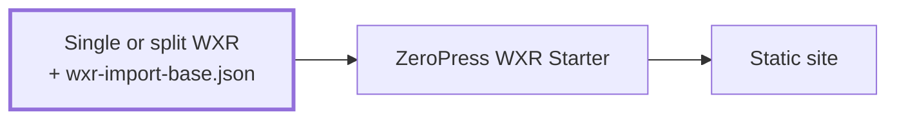

# ZeroPress Static

Keep WordPress as your editor and publish a static site with
[ZeroPress WXR Starter](https://github.com/zeropress-app/zeropress-starter-wxr).
ZeroPress Static publishes your content and build settings to GitHub, where your
connected build service can build and deploy the site. For your first site, we recommend
GitHub publishing with Cloudflare hosting. Follow the [first-publication
walkthrough](#first-publication-with-github-and-cloudflare) below.

The static site uses a ZeroPress theme. Your active WordPress theme is not exported.

Requires WordPress 6.8+, PHP 8.2+, and a single-site installation.
Saving GitHub tokens and Turnstile secret keys requires PHP OpenSSL with
AES-256-GCM support.
License: GPL-2.0-or-later.

The admin interface is available in English, Korean, Japanese, Spanish (Spain),
German, French and Portuguese (Brazil). It follows
your WordPress user language, or the site language when no user language is set.

## Cost and accounts

ZeroPress Static is free and open source. All features are included, with no paid plans,
subscriptions or hidden fees. You do not need a ZeroPress account.

Our recommended setup uses your own GitHub and Cloudflare accounts. Both services offer
free plans with usage limits. Paid options, WordPress hosting, custom domains and
newsletter services may have separate costs under each provider's pricing and terms.

## Publishing flow

ZeroPress Static generates WXR content and `wxr-import-base.json`. The starter
builds them as one site. Small exports and downloads use `wordpress-export.xml`;
large GitHub publications can use [split WXR files](#split-publication-and-starter-compatibility).



## Installation

### Automatic installation

Install ZeroPress Static from the WordPress Plugin Directory:

1. In your WordPress admin, open **Plugins → Add New Plugin**.
2. Search for **ZeroPress Static**.
3. On the ZeroPress Static result, select **Install Now**, then **Activate**.
4. Open **ZeroPress → Settings** to configure the plugin.

### Manual installation

Download the installation ZIP from the repository's
[releases](https://github.com/zeropress-app/zeropress-static/releases). In
WordPress, open **Plugins → Add New Plugin → Upload Plugin**, select
`zeropress-static-v<version>.zip`, install it, and activate it.

For a source checkout, copy this directory to
`wp-content/plugins/zeropress-static/` and activate it in WordPress. The plugin
files are ready to use; installation requires no Node.js, Composer or build step.

## First publication with GitHub and Cloudflare

We recommend GitHub publishing with Cloudflare hosting for your first site. This setup
connects publication to automatic builds and deployments, so you can update your site
from WordPress. Create an account with each service before starting. Cloudflare provides
a site address, so you can start without a custom domain.

1. **Deploy the sample site.** Open [ZeroPress WXR
   Starter](https://github.com/zeropress-app/zeropress-starter-wxr) and select **Deploy
   to Cloudflare**. Connect your GitHub account, choose **Create private Git
   repository**, and keep the Starter's default build and deployment settings. When
   deployment finishes, open the site address provided by Cloudflare and confirm that
   the sample site appears.
2. **Return to WordPress.** After the sample deployment, continue here with the plugin;
   it prepares your content export for you. Open **ZeroPress → Settings → Site**, enter
   the new site's address under **Static site URL**, and select **Save site settings**.
   Leave the other settings at their defaults for this first publication.
3. **Connect your repository.** Under **GitHub publishing**, enter the URL of the
   repository created in step 1. Set **Publishing branch** to the branch Cloudflare
   builds for the live site, usually `main`, and select **Save publishing target**.
4. **Register a GitHub token.** Select **Create a GitHub token**. Choose **Only select
   repositories**, select your publishing repository, and grant **Contents: Read and
   write**. Copy the generated token back to WordPress, select **Register token**, then
   **Test connection**. Continue when the test succeeds.
5. **Publish your content.** Make sure WordPress has at least one public, published post
   or page. Open **ZeroPress → Publish**, select **Prepare publishing data**, and review
   the content counts and destination. Select **Publish to GitHub** and confirm.
6. **Check your live site.** GitHub publication updates the repository; Cloudflare then
   builds and deploys the site. In Cloudflare, open your project under **Workers &
   Pages** and wait for the new build and deployment to succeed. Open or refresh the
   site address from step 1 and check that your own posts and images appear in place of
   the sample content.

After checking the site, enable **Allow search engines to visit this site** under **Site** if you
want search engines to crawl it. This option starts off. Save the site settings, then
prepare and publish again. You can configure menus, comments, newsletters and media URL
replacements later as needed.

GitHub publishing replaces `wordpress-export.xml` and `wxr-import-base.json` in one
commit. Manage their settings in the plugin; direct edits to the generated files are
replaced on the next publication.

## Publish from the editor

After GitHub publishing is configured, administrators can publish without leaving
the post or page editor. In the classic editor, select **GitHub** beside **Update**
or **Publish**. In the block editor, select the cloud upload icon beside **Save**
or **Publish** (tooltip: **Open GitHub publishing**), or choose **ZeroPress publish**
from the **⋮** options menu. The menu entry is also available on small screens,
where the toolbar icon is hidden.

Save your changes in WordPress, open the dialog, and select **Prepare publishing
data**. Review the result and select **Publish to GitHub**. This publishes all
saved public posts and pages, not just the post being edited. Unsaved changes
block preparation and publication. If GitHub already contains the same data,
the dialog shows that no publication is needed.

When a static site URL is configured, **View on static site** links to the
current public post or page before and after publishing. It opens the deployed
page; saved changes appear there after the site's build and deployment finish.

## Settings

All options are on **ZeroPress → Settings**. Use the section links to move within
the page. The navigation stays visible while scrolling on desktop and wraps on
mobile. Save changes before preparing publishing data.

The **Site** section shows the WordPress title, description, site language,
timezone and site icon as read-only information. A link opens the WordPress
general settings. These values are read again whenever publishing
data is prepared. **Icon URLs for publishing** shows the URLs after saved media
replacement rules have been applied.

Under **Static site settings**, set the static site's address, **Posts per page**
and search-engine preference. Posts per page is a positive whole number and
controls the static site's post listings. Saving it does not change WordPress's
Reading settings.

Existing sites continue to use the WordPress page size until a separate value is
saved in the Site section. The input initially shows that effective value.
Saving **Site settings** stores the displayed number for the static site.
Saving other sections or older clients omitting `posts_per_page` preserves this
behavior and any previously saved override. Changing the page size expires
prepared data, so prepare and publish again. The exported value still uses
`site.posts_per_page` in `wxr-import-base.json`; the importer format is unchanged.

### Static site URL and search engines

Enter the static site's address without a path, for example
`https://blog.example.com`. It is required when comment writing is enabled.
Otherwise, leaving it blank omits `sitemap.xml`, `feed.xml` and the
`<link rel="canonical">` tag that identifies a page's preferred URL.

When set, this address is also used for the WXR site addresses, post and page
links, and menu links within the WordPress site's address. Paths relative to the
WordPress home address are kept, with any WordPress installation subdirectory
removed. Queries and fragments are preserved. WordPress can therefore use a
separate hostname for administration while the static site keeps its address.
With no static site URL, the WXR retains the WordPress addresses.

This applies to WXR link fields. Links within article bodies keep their saved
addresses. Media URLs follow the media replacement rules, and comments use the
configured WordPress REST API URL.

**Allow search engines to visit this site** starts off. When unchecked, the default build
writes `Disallow: /` in the static site's `robots.txt`; checking it writes
`Allow: /`. A custom `public/robots.txt` in your build project takes precedence.
The setting controls crawler instructions; access to a private site is managed
by your hosting.

### GitHub publishing

**Test connection**, the prepared publication, and the publishing dialogs show
the repository's full name as a GitHub link, its branch, and an icon badge for
its visibility: **Private repository**, **Public repository**, or **Internal**. The badge is
**Unconfirmed** until visibility is checked. Connection results describe the
target that was tested, including unsaved settings; editing the connection
settings clears the previous result. A private repository is recommended for source
files; it can still build a public website. Public repositories remain supported,
but anyone can view uploaded WXR and site settings files and their Git history.
Review the public-repository notice before publishing.

Publication checks the reviewed visibility before sending files or other Git
writes in each request, and again before the final branch update. If visibility
changes, prepare again and review the new destination before publishing. An
unavailable or unrecognized visibility is never treated as private. These checks
cannot lock GitHub's visibility setting or prevent an owner from changing it
later. Read-only verification of an uncertain publication remains available.


Enter the repository URL and an existing **Publishing branch**, then select
**Save publishing target**. The branch field starts with `main`.

Create a fine-grained token for **Only select repositories**, select **only the
publishing repository**, and grant **Contents: Read and write**. Use **Register
token**, then **Test connection** to check access to the branch and its export inputs.
The branch must allow direct commits for publishing to succeed.

Token registration is separate from saving the publishing target. A registered
token is shown as a status. To replace it, use **Delete saved token**, confirm,
then register a new token. Deletion removes the plugin's stored copy; revoke the
token on GitHub if you also want to invalidate it there.

### Media URL replacements

Use this section when exported media should use a different address. Add source
and destination prefixes, for example:

| Source URL prefix | Destination URL prefix |
| --- | --- |
| `https://blog.example.com/wp-content/uploads/` | `https://media.blog.example.com/wp-content/uploads/` |
| `https://old-wp.example.com/wp-content/uploads/` | `https://media.blog.example.com/wp-content/uploads/` |

Trailing slashes are added automatically. If several rules match, the longest
source prefix wins. Each original value is replaced once, preserving the rest of
the path, query and fragment.

Rules apply to media URLs in saved HTML, supported media-block attributes,
attachment URLs and site-icon URLs before export. Ordinary article links retain
their addresses, and shortcodes are not executed. The rules change exported URLs;
files remain at their existing locations. The destination URLs must serve the
media to your site's visitors.

The WordPress Site Icon supplies the favicon and Apple touch icon using
WordPress's 512 and 180 size requests. The 512 request selects the full Site Icon
attachment, which may already be cropped. If no Site Icon is set, the build
project's icon defaults remain in place.

### Menus

Select a classic WordPress menu for `primary`, `footer`, or a custom ID used by
your static theme. Choose **Not selected** to leave a slot empty. Only selected
menus and their public targets are exported. The same source menu can serve more
than one ID. Select **View items** beside a selection to inspect its labels,
links, hierarchy and new-window settings without saving or leaving this screen.
**View items** appears only when an available menu is selected. The preview uses
saved site settings for link destinations; unsaved menu selections can still be
inspected. Preparation excludes unavailable or non-public targets.

Create and edit menus in WordPress's classic menu editor, available with themes
that support it. Assignments in this plugin are independent of WordPress theme
locations. Block navigation is not supported. Renaming a selected menu preserves
the assignment; deleting it requires choosing another menu or clearing the slot.
Theme-provided links, such as a home link, are controlled by the static theme.

Custom IDs start with a lowercase letter and may contain lowercase letters,
digits, hyphens and underscores, up to 64 characters. `constructor` and
`prototype` are reserved. Selections are exported as `import.menu_mapping` in
the base JSON.

### Search and content navigation

Search, RSS and chronological archives start enabled. RSS also requires a static
site URL; the selection is retained if that URL is blank. Search and archive
display depends on the theme. **Enable search on the static site** controls site search separately
from the search-engine crawling setting.

### Comments

Comment display and writing are separate options, both off by default. To display
comments, enter a WordPress REST API URL accessible to site visitors, such as
`https://wp.example.com/wp-json/wp/v2`. A subdirectory installation can use
`https://wp.example.com/blog/wp-json/wp/v2`. Original post and page IDs are preserved.
Query-style `?rest_route=` URLs are not supported.

With display enabled and writing disabled, the blog theme shows the comment list
without a form or reply buttons. **Allow comment writing on the static site**
requires a saved **Static site URL**. Leaving **Use Cloudflare Turnstile**
unchecked uses the built-in proof-of-work (PoW) check, which needs no keys.
WordPress's login requirement, closed comments, moderation and spam checks still
apply.

To use Turnstile, configure its widget for the static site's hostname. Check
**Use Cloudflare Turnstile**, enter the matching Site Key and Secret Key, and
select **Save Turnstile settings**. The saved Site Key remains visible; the Secret
Key is represented by its storage status. **Change keys** replaces the pair;
**Cancel** restores the saved settings. Turning Turnstile off retains the keys.
**Delete saved keys** removes both keys and turns it off, so enabled comment
writing continues with PoW.

Comment display and API URL changes require republishing. Writing and Turnstile
settings apply when the theme next checks the writing policy, without rebuilding
the site. With comment display off, the supported theme makes no comment API
requests.

#### API access

The WordPress admin can stay private while these paths are accessible to site
visitors:

| Path | Methods | Purpose |
| --- | --- | --- |
| `/wp-json/wp/v2/comments` | `GET`, `POST` | Read comments and submit comments or replies |
| `/wp-json/zeropress-static/v1/comments/policy` | `GET` | Read the writing policy |
| `/wp-json/zeropress-static/v1/comments/challenge` | `POST` | Obtain verification data before submission |

Read-only comments use the two `GET` endpoints. Preserve query parameters such
as `?post=123&page=2`. Include any WordPress installation subdirectory in every
path and allow `OPTIONS` where CORS preflight is needed. Network and proxy
configuration are managed on your server.

Challenge requests and comment submissions marked `zeropress_client=theme-v1`
must send an `Origin` matching the saved static site URL, including the scheme,
hostname and port. A preview at another address can read comments but cannot
submit them. Turnstile also verifies the widget hostname and action.

The marker selects this integration; it does not authenticate a theme. Other
REST clients retain their existing WordPress comment policies, subject to the
optional public REST access restriction below. A custom HTTP client can
supply an Origin header, so the origin check supplements PoW or Turnstile
verification. The theme retains the comment list if the writing policy cannot be
loaded and offers a retry. Uncertain comment submissions are not automatically resent.

#### Comment request limits

Each IP address can make **60 challenge requests** and **5 marked comment or
reply submission attempts per minute**, shared across all posts. The two quotas
are separate and reset at each minute boundary. Failed verification attempts
also count. Limits are checked before PoW or Turnstile verification; exceeding a
quota returns HTTP `429`, with a `Retry-After` header and `data.retry_after` in
the JSON response indicating the seconds to wait. Reading comments and policies,
and unmarked clients using WordPress's existing policies, are unaffected.

The client address comes from PHP's `REMOTE_ADDR`. If WordPress runs behind a
proxy, configure the trusted web server to restore the visitor's IP address;
otherwise visitors may share the proxy's quota. The plugin does not trust
client-supplied forwarding headers. Counters store a keyed hash of the address,
are excluded from option autoloading, and expired records are cleaned up in
bounded batches as new counters are created. Uninstalling removes these records.
If the client address or counter storage is unavailable, submissions return HTTP
`503` until the server can enforce the limits again.

### API protection

**Settings → API protection → Only expose APIs needed for comments** is off by
default. When enabled, it restricts unauthenticated HTTP REST requests according
to the saved **Show WordPress comments on the static site** setting:

| Comment display | Public REST access |
| --- | --- |
| Off | All REST routes are blocked. |
| On | Only the three comment routes listed above are allowed, with their listed methods. `HEAD` is allowed for reads and `OPTIONS` for CORS preflight. |

When this option is selected and saved comment display is off, the settings
screen explains that all public REST API access is restricted.

The restriction checks WordPress's resolved route and effective HTTP method,
including embedded REST requests. Unauthenticated REST requests with a
client-supplied `rest_route` query or form field are rejected, including
query-style `?rest_route=` URLs. Changing the visible URL path cannot grant
access to a different REST route. Blocked routes return HTTP `403`; rejected
route overrides return HTTP `400`.

WordPress REST authentication runs first. Valid cookie-and-nonce or Application
Password authentication retains WordPress's normal capability checks, including
for the block editor. A login cookie without a REST nonce is treated as
unauthenticated. Server-side REST calls outside an HTTP REST request keep their
normal behavior.

Saving API protection or comment display settings changes API access immediately;
no static publication is needed. Comment writing settings, Origin checks,
PoW/Turnstile and request limits still apply. Public REST APIs used by other
plugins are also restricted. WordPress pages, media files, admin-ajax and XML-RPC
are outside this option's scope.

Restricted REST responses send no-cache headers. If a CDN or server cache already
stores REST responses, clear them and configure it to bypass REST caching so
requests reach WordPress and its current access policy.

### Newsletter connection

Prepare a signup page with a newsletter service such as Hostinger Reach,
Omnisend or Mailchimp, then enable **Show newsletter signup**. This section
connects the static site to that page; the service handles subscriptions and
mail delivery.

- **Signup page URL** opens in a new tab.
- **Embedded signup page URL** opens in a popup in the blog theme. The page must
  allow iframe embedding. If both URLs are supplied, the signup link is also
  available as a fallback.

At least one URL is required. Use an HTTP(S) page URL or a site-relative path
such as `/subscribe/`, including any query or fragment. Enter a page address,
not an HTML embed snippet or form-submission endpoint.

Title, description and button text are optional; blank fields use the theme's
defaults. Title and button text allow 200 characters, description 2,000, and each
URL 2,048. Turning the prompt off retains the saved values.

### Display and credits

**Site footer text** is optional plain text, such as your site name or a copyright
line. Leave it blank to hide the text. **Show ZeroPress attribution** adds
`Published with ZeroPress` to the theme footer. Footer text and attribution
depend on theme support.

**Show ZeroPress generator information** adds `<meta name="generator">` to the
HTML. Attribution and generator information both start on.

## Publishing behavior

Prepare data again after changing settings or content. Preparation expires after
ten minutes. Changes to the target files on GitHub also require preparing again;
unrelated repository commits are preserved.

When the prepared data matches the previous publication, **No changes to publish**
confirms that publishing is unnecessary. To publish intentionally, open
**ZeroPress → Publish**, expand **Republish options**, and select **Publish to
GitHub again**. This creates a new commit by updating the WXR generation time.
Post dates and build settings stay unchanged. This can trigger the build service
configured for your repository. The branch is never force-updated.

The admin page's **Publish to GitHub** and **Publish to GitHub again** confirmation
dialogs stay open when you click outside them. Use **Cancel**, the close button
or **Esc** to dismiss them without publishing.

The admin page and editor group progress, results and recovery buttons under
**Publication status**. Blue indicates progress, no changes or an intentional
pause/cancellation; yellow asks for attention, including expired approval and
an unconfirmed result. Green confirms publication to GitHub; red reports a
confirmed failure. A GitHub publication still needs the connected hosting
service to finish its build and deployment before the public site changes.
Preparation details and any blocking reason remain in **Publishing data**.
When ready, **Publish to GitHub** is the primary action; during recovery,
**Continue publication** or **Check publication result** takes priority.
Downloads are grouped separately on the admin page.

A lost browser response or a terminated server request can leave the branch
update unconfirmed. The plugin does not repeat an uncertain branch write.
If **Publication needs verification** appears, open **ZeroPress → Publish** or
the editor's publishing dialog and select **Check publication result**. These
checks are read-only; do not publish again until the result is confirmed. See
[interrupted publication and recovery](#interrupted-publication-and-recovery)
if verification remains unresolved.

### Split publication and starter compatibility

A split-capable starter declares support with the exact
`zeropress-wxr-input-v1.json` marker. The plugin verifies its Git blob hash from
tree metadata; it does not download remote file bodies. Follow the
[starter upgrade and troubleshooting guide](https://github.com/zeropress-app/zeropress-starter-wxr#split-wxr-input)
before enabling this capability on an existing site. Adding only the marker
does not upgrade the importer or build scripts.

Choose **WXR publishing format** under **GitHub publishing** and save the publishing
target before preparing again. With **Files** processing, the settings
work as follows. **Memory** processing uses [single XML only](#export-processing).
Selecting Single XML does not select Memory processing.
The help below the selector follows the selected format immediately. With Memory
processing, Automatic is described as single XML and Split XML remains unavailable.
Changing a selection does not apply it until the publishing target is saved.

| Setting | Behavior |
| --- | --- |
| **Automatic** (default) | Splits WXR files larger than 8 MiB, or when required by upload size or server memory. Existing split exports stay split. |
| **Single XML** | Publishes WXR as one XML file. Publication may be limited by file size or server resources. |
| **Split XML** | Publishes WXR in split format. |

Single XML can replace a verified split export. A failed size, memory or time check
stops publication and offers next steps; it does not silently switch formats.
Split XML applies even to small exports; it does not mean one file per post.

These formats describe the WXR content. Build settings are a separate
`wxr-import-base.json` file in either format. **Download WXR** always provides
one XML file, and **Download build settings** provides the separate JSON file.
Keep custom starter settings in `wxr-import-base.override.json`; publishing
replaces the generated base settings and preserves the override file.

With the verified capability marker, Automatic keeps an existing single XML only
when both its raw size and encoded upload request fit 8 MiB and the memory check
passes. Explicit **Single XML** uses
the existing single-file transport checks instead of this automatic threshold.
It still needs enough PHP memory for a complete encoded upload. Older starters
can use Automatic or Single XML while the single-file checks pass; Split XML
requires upgrading the complete starter, not just adding its marker.

Split publication uses `wordpress-export.manifest.json`, content-addressed XML
parts under `wordpress-export.parts/`, and the same `wxr-import-base.json`.
The **Publishing data** card in the preparation result and editor lists post,
page and menu counts under **Content**, with a separate **Media information**
count. Media information counts the attachment records included in WXR, not
the Media Library total or the number of image files. Featured images retain
their addresses, dimensions and alternative text. Body-only media usually need
no separate metadata because their URLs are already in the saved content. The
export keeps only enough additional attachment URLs to preserve the importer's
existing media-prefix inference, including sites without featured images and
sites with multiple media domains. Unusual URL spellings are kept individually
when they cannot be safely grouped. Actual media files are not copied or uploaded
to GitHub. The card also lists the WXR format and the separate
JSON build settings. Split exports also
show the XML part count and explain that WXR downloads remain a single XML file.
The card also shows the downloadable WXR and build-settings sizes, their total
(excluding media files), and the preparation check result. In Memory processing,
it shows the percentage of the 8 MiB limit for publishing data used by the largest of the
combined raw files, encoded XML upload, and encoded settings upload. This is not
PHP RAM usage or a supported post count. An encoded upload can exceed the limit
even when the downloadable files are smaller. Files processing does
not show this memory-mode percentage.

Select the menu count or media information count in this card to inspect the
records from that preparation. Counts of zero are plain text. Menu details show labels, destination links,
hierarchy, new-window settings and assigned theme menu IDs. The **Edit in
WordPress** link opens the classic menu editor when the active theme supports it.
Media details show the exported URL and whether the record describes a featured
image or preserves media URL inference. These are read-only text lists: opening
them does not load images or contact media servers. Lists are fetched one page
at a time, with up to 50 records per page.

Menu destinations use the static site address and the default WXR importer's
post, page, category and tag routes. Custom and external links keep their
meaning. Category and tag links can therefore differ from WordPress's archive
URLs. Changes to routes in the starter's override file are outside this preview.
An unresolved destination is labeled for resolution during the site build,
rather than showing a WordPress source URL as a confirmed destination.

Prepared details remain tied to the last preparation, even if WordPress content
changes afterward. Prepare again to review later changes. If details expire or
are evicted from the cache, prepare again or inspect the downloaded WXR.
The settings preview inspects eligible source links through the existing guarded
reader without generating files or contacting GitHub. Both views retain the
request's memory/time budget. Optional route metadata has a separate bounded
allowance; unsupported normalization or exhausted display capacity leaves the
destination unresolved and does not change the export contract.

The preparation result appears in a separate area at the bottom of the card:
a green check for a passed preparation, a warning when publishing is blocked,
or an information icon when GitHub needs to be connected. Each state also has a
text label, so its meaning does not depend on color.
Preparation checks do not write to GitHub. A passed check describes that
preparation only: available memory, remaining request time, content, settings and
GitHub state are checked again during publication. A download-only result shows
the blocking reason or asks you to connect GitHub and prepare again. If generation
itself exceeds a resource limit, preparation stops with its existing error instead
of showing a completed export card.

Any format change is shown below these details. Switching
to split removes `wordpress-export.xml` in the same commit; switching to single
removes the verified manifest and managed parts directory in that commit.
Content need not change to publish a format change. Changing a preference without
changing the resulting format or content does not require another publication.
The capability marker, theme, public files and user override remain untouched.

Parts contain complete records and target 4 MiB. Each XML part and the base are
bounded at 8 MiB, including their UTF-8 JSON upload request; the manifest is
bounded at 1 MiB and the inventory at 256 parts. A single oversized record is an
error, never a truncated or partial export. These are transport policies, not a
universal post-count limit. WXR and base settings semantics are unchanged.

Every part and the base are bound by exact byte size and SHA-256 in the manifest.
The legacy logical data hash remains independent of generation time and part
boundaries. The importer validates the whole inventory and performs global
inference once, preserving forward media references and page/menu relationships.

Publication uploads one checked part at a time, reuses unchanged part blobs, and
updates the complete generation with one non-forced branch write. The root tree
preserves unrelated files, including the override and theme. The managed parts
subtree is replaced only when existing publication trailers bind its current
tree, manifest and base; unexpected files or modified/incomplete generations
stop publication. Do not store custom files in that directory.

Split exports select repeatable part boundaries from WordPress record IDs and
keep the existing content order and size checks. A length change, insertion or
deletion can therefore reuse later unchanged parts after the next shared boundary.
The fixed selection rate is approximately one boundary per 1,024 IDs; it is not
a maximum part length. This may create more files on the first publication.
When the extra boundaries would exceed 256 parts, the exporter uses the previous
size-based layout if it fits. Changes to shared site fields, switching layouts
or crossing that fallback can still replace many parts. An unchanged existing
publication is not rewritten merely to adopt the new layout.

Both single and split publication reuse file blobs whose exact Git SHA matches
the current verified target, including unchanged build settings. This avoids
resending identical bytes without reading remote file bodies. Dated XML or
manifest files still change during explicit republication; reuse does not skip
the new publication commit. Confirmed uploads in an active publication can also
be reused when that publication resumes.

The review receipt fixes the actual single or split format as well as logical
content, settings revision, user, target and expiry. Later requests use that
approved format even when memory headroom changes. Saving a different preference
requires a new preparation. It cannot bypass an unresolved publication: checking
an uncertain result remains read-only and uses the original commitments.
Content or managed-target changes require a new preparation. Metadata-only
ownership checks and uncertain-write reconciliation remain in force. Split blob writes are sequential, with at least
one second between completed mutations. Shared pacing and rate-limit cooldowns
survive retries, cancellation and new publication attempts.

### Interrupted publication and recovery

With **Files** processing, the admin page and both post editors publish
through a sequence of authenticated requests. **Memory** processing uses
[one publication request](#memory-processing) on both Linux/Unix and Windows.
The pause and resume controls below apply to Files processing.
Each ordinary publication step inspects one metadata object or uploads one
blob/tree/commit. The final request regenerates the source at the approved
snapshot's timestamp, checks its full logical hash and transport plan, and checks
the branch HEAD before one non-forced reference update. Unrelated branch changes
can rebuild the candidate after full reinspection; managed-file or capability
marker changes stop publication. No incomplete generation is exposed on the
branch. GitHub's `force: false` enforces fast-forward behavior, not an exact
expected-old-SHA compare-and-swap against external forced resets.

If the page closes or a connection is interrupted, open **ZeroPress → Publish**
or the editor's publication dialog. **Continue publication** resumes confirmed
progress, **Check publication result** performs read-only verification, and
**Cancel publication** cancels work that has not reached final dispatch.
While capturing the publication snapshot, uploading files or continuing a
publication, **Pause publication** stops after the current request finishes,
without a confirmation dialog. It does not abort the request or cancel the
server job. Once paused, choose **Continue publication** to resume saved
progress or **Cancel publication** to discard the unfinished job.
A pause stops the current page from sending another publication step; it does
not stop another page that is already running the job. Lost responses still
require a status check, and an uncertain final result must be verified.
Pausing is unavailable once the final branch update is dispatched and during
uncertain-result verification; the confirmed result takes precedence.
Opening a page only reads status: it does not publish or resume automatically.
There is no background publisher. The original ten-minute approval, owner,
settings revision and target remain binding; pausing or resuming does not
extend approval. After expiry, cancel the job and prepare again.

Before sending the final branch update, the server durably records the candidate
commit and expected files. If its outcome is uncertain, it never sends another
final update for that job. Verification requires the candidate at HEAD or in
relevant managed-file history together with exact file and data commitments.
An old HEAD or the mere existence of a candidate commit is not proof of failure
or success. An unresolved job continues blocking new publication, including the
legacy one-request API, after expiry and cancellation attempts. Restore access
to the original target and use **Check publication result**. If proof remains
unavailable, investigate the branch history with the maintainer; deleting the
local journal is not a safe retry procedure.

The server maintains one active job per WordPress installation. A bounded,
non-autoloaded option holds IDs, hashes, progress and results, but no credentials,
receipts or WXR bodies. With Files processing, a private snapshot directory holds the approved bytes;
files use mode `0600` and directories `0700`. Contents and file identity are
checked again before upload. An exclusive per-site OS file lock prevents parallel
workers; time passing never authorizes taking over a live worker's lock.
Duplicate/stale request IDs return current status rather than repeating a step.

Files processing requires private local storage with stable file identities,
POSIX permissions and working cross-process locks. The following storage and
cleanup requirements apply to that method. Memory processing uses a database
connection lock; see [Memory processing](#memory-processing).
PHP and WordPress version checks alone do not establish that either backend is supported.

The default snapshot directory is under PHP's system temporary directory.
`ZEROPRESS_STATIC_PRIVATE_DIR` can select an existing private parent for both
export spools and publication snapshots. Its site-specific subdirectories remain
separate. Without this constant, existing Unix paths and ownership records stay unchanged.
It must remain available across requests, outside the web/document root and
uploads, with private ownership, stable file identities and working exclusive
locks. Multiple PHP workers must see the same supported filesystem; separate
per-container temporary directories do not provide this guarantee. Hosts can
select a suitable private directory with
`zeropress_static_publication_directory` for snapshots only; export spools still
use the parent described above. Public paths and unsafe permissions are
rejected. Storage without these guarantees, including unsupported filesystem
semantics, stops publication with a controlled error rather than an unsafe
fallback. Plan disk space for the snapshot plus export spools; capture checks
free space for the snapshot, twice the WXR size and a 16 MiB reserve. A disk-space
check is not a reservation against other processes.

Completion, cancellation and opportunistic expiry cleanup remove owned snapshot
files while holding the lock. The stable lock file remains. Deactivation or
uninstall cancels pre-dispatch work and attempts private-file cleanup; a busy
worker is not interrupted or unlocked. The small control journal is retained,
especially an unresolved final-write fence: removing local files or uninstalling
the plugin cannot roll back a GitHub write. Abrupt host termination may still
require later private-file cleanup. A missing snapshot before dispatch requires
cancellation and fresh preparation; read-only final-result verification can
continue without snapshot bodies.

### Manual downloads

For a custom build or hosting setup, prepare and download `wordpress-export.xml` and
`wxr-import-base.json` from **ZeroPress → Publish**. Place both files in the WXR Starter
project root, then follow your host's build and deployment instructions. If the
repository already uses split WXR, follow the starter guide to replace the
complete generation; do not keep XML and the manifest side by side.

## Export scope and limits

Each eligible post/page body warns from **256 KiB (262,144 UTF-8 bytes)** and
blocks preparation/publication above **4 MiB (4,194,304 bytes)**. Exactly 4 MiB is
allowed. Markup, whitespace and inline data count; linked media files do not.
The stored body and its media-rewritten form are checked. Split or shorten the
identified post, then prepare again. Saving/editing the WordPress post remains
available; the plugin never truncates it or silently leaves it out of an export.
Increasing PHP memory does not bypass this plugin policy. The importer and
builder warn at the same threshold but have no fixed body maximum by default;
their callers can set `--max-body-bytes` / `maxBodyBytes`. Studio retains its
separate 1 MiB write limit. This change does not add Base64 image support.

The 4 MiB allowance does not replace the export or resource guards. XML overhead
and JSON escaping still count toward the separate WXR part and encoded GitHub
request limits, so an accepted body can still produce a controlled export or
upload-size error.

Preparation shows an aggregate warning with a count, largest body and at most
20 example post IDs; it does not require extra approval. Warnings are excluded
from signed content, hashes and export files. A refusal before branch mutation
leaves the previous publication intact. An already uncertain publication keeps
its verification flow rather than being declared unsuccessful by a body error.

The reader selects bounded ID windows, reads UTF-8 row lengths, and then loads
complete rows in byte-budgeted batches (2 MiB target, reduced by the existing
memory guard). An admitted row larger than the target is loaded alone after
the whole-row memory check; the batch target is not raised to 4 MiB. Every
fetched variable column counts, including titles/excerpts.
The payload SELECT rechecks body and row sizes, so growth after preflight returns
a controlled size/source-change error instead of an oversized payload or an
omitted post. An unusually large non-body field can still trigger the resource
guard; it is not mislabeled as a body-policy error.

Normal SQL selection filters remain active. `posts_results` and `the_posts` run
on each admitted byte batch; a batch may contain fewer than 100 posts. Result
filters may only retain/reorder/modify selected posts. Query short circuits,
unsafe projections and added/duplicate result IDs fail with `SOURCE_READ_UNBOUNDED`
instead of falling back to an unbounded query. Third-party callbacks can allocate
memory themselves; these protections do not impose a global memory bound on
other plugins. Original cache, deadline and source/receipt checks remain in force.

Required metadata and attachment fields are admitted before the database sends
large values to PHP. Reads use private batches of up to 100 IDs with a 2 MiB
payload target, reduced when live memory headroom requires it. Unused independent
metadata keys and unexported attachment bodies are not loaded. Referenced media
URLs are checked first; full attachment metadata is read only for featured
images. Body-only media do not load dimensions or alternative text unless another
WordPress callback explicitly requests those values through the same guarded
reader. All referenced URLs retain their existing validation even when their
attachment records are omitted. Complete metadata
values needed by WordPress filters and site-icon selection are preserved; their
serialized size and array expansion are checked before decoding. An unused member
inside a required value still counts. A value that cannot fit produces a controlled
memory error instead of a partial export. There is no new fixed metadata-size limit.

First-value metadata behavior, missing/default values, attachment URLs, taxonomy
filters and menu order are preserved. Partial metadata or attachment projections
are never put into WordPress's shared whole-object caches. Unsafe custom query
shapes or serialized objects fail with `SOURCE_READ_UNBOUNDED`; review unusual
metadata and plugins that customize content or media before preparing again.
These checks cannot bound allocations performed inside third-party callbacks.
They do not change private file ownership, cleanup, final source validation or
verification of an uncertain GitHub publication.

Downloads are saved only after the browser has received the complete file and checked its decoded byte count against the preparation result. An interrupted transfer can still start with HTTP 200; the updated plugin does not treat that status alone as success or append an error document to a partial file. If no file was saved, retry the download. If it keeps failing, ask your host to review connection and request time limits. Expired or changed preparations require preparing again.

The server retains bounded reads, the original request budget and the selected backend's ownership lock throughout delivery. It sends `Content-Length` only when PHP's output path is known to preserve bytes; the browser also checks downloads with compressed or reframed responses. This is a completion check, not a content checksum, a resumable download or an extension of hosting time limits. Download failures do not retry or clear a GitHub publication whose outcome is uncertain.


The export includes published posts and pages without passwords, their used
categories and tags, public author display names, selected classic menus, and
required media metadata. Drafts, private or scheduled content, comment records,
login names, user email addresses and arbitrary post metadata are excluded.
Information written into published content remains part of that content.

Saved HTML and static block markup are exported. Shortcodes, dynamic blocks and
page builders are not executed; custom post types and block navigation are not
converted. Excerpts and taxonomy descriptions are exported as plain text.
Titles and other display text are decoded once to preserve characters such as
apostrophes and ampersands.

Publishing is a manual full export. Preparation, downloads and publication are
separate operations. Downloads regenerate the data; Files publication captures a
validated snapshot at start and regenerates it again before final dispatch.
The memory path generates and revalidates the source within its single publication
request without retaining an export snapshot between requests.
Each request shares its original resource budget across generation and GitHub
communication. The legacy PHP publication API still performs a single request,
with the same site lock, durable final-write fence and pacing protections.

With Files processing, WXR records are written to registered, request-owned files in a private subdirectory
of PHP's system temporary directory, then assembled into a single XML or bounded
parts. Downloads replay that file in bounded buffers after receipt and content
validation. Each open file retains an exclusive lock until its last read and
close. Files are never stored in WordPress uploads or exposed by URL. Publication
additionally copies approved artifacts into the separate, resumable snapshot
[described above](#interrupted-publication-and-recovery).

Normal close removes the registered file. If a worker is terminated or deletion
fails, a later authorized preparation, download, publication step or cancellation
can reclaim abandoned files after verifying their signed ownership, file identity
and available lock. Recovery is bounded per request and may take several requests.
It never deletes a live locked file, follows a link, repairs foreign ownership,
or sweeps generic `php*` files. Deactivation and uninstall also attempt one
bounded pass. Status polling and uncertain-result verification do not run a sweep;
recovery never changes the publication journal or final-write fence.

Export spools have the same private-filesystem requirements as publication
snapshots. Both locations must be writable by the PHP worker. Export spools use
PHP's `sys_get_temp_dir()` unless `ZEROPRESS_STATIC_PRIVATE_DIR` is set;
WordPress's `WP_TEMP_DIR` does not redirect them.

The host must provide private local temporary storage with stable file identities,
working cross-process locks, and room for the item spool and assembled WXR
(approximately twice the WXR size during assembly). Public paths, permissive
permissions and unsupported storage fail with the existing controlled storage
error; the publication-directory filter does not redirect these export files.
Small ownership/lock/cursor controls remain after cleanup. A quiet site, invalid
or incomplete registrations, a large backlog, or files from an earlier plugin
storage format or WordPress salt generation can still require host-assisted
review. This recovery does not guarantee a time-based purge or support for
multi-node storage.

The exporter releases in-memory object caches between batches when the active
cache implementation supports runtime-only flushing. It never substitutes a
flush of shared persistent caches. Without runtime-flush support, it suspends
cache additions during export and restores the prior setting afterwards;
third-party cache implementations can still have different memory behavior.

For these operations, the plugin requests WordPress's administrator memory
allowance (`WP_MAX_MEMORY_LIMIT`) and checks the effective PHP `memory_limit`.
Generation and downloads check working records and replay buffers instead of
charging disk-resident WXR as a live string. Large individual records and
collected metadata still consume memory. Single-file publication reads the whole
XML into a UTF-8 JSON request; split publication holds only one bounded part and
its request. Both check the encoded size before materialization/serialization.
Preparation also checks the publication plan, but later requests can have less
headroom, so publication rechecks it.
The estimate retains its conservative headroom; it is a preflight check, not a
measurement of peak usage. Increase the server's PHP memory allowance and, when
needed, `WP_MAX_MEMORY_LIMIT` if this check stops an export. Hosting restrictions
may prevent WordPress from raising the limit.

With a positive PHP `max_execution_time`, the plugin stops starting work five
seconds before that setting's duration has elapsed since the request began.
This is a wall-clock budget including WordPress startup and network waits; PHP's
own execution-time accounting can differ. A setting of `0` leaves the overall
request budget unlimited. PHP-FPM, web servers and proxies can still terminate
requests according to their own limits.

GitHub HTTP requests use the remaining time. When PHP has no execution-time
limit, each GitHub request defaults to a 30-second timeout. Ordinary resumable
steps additionally cap each HTTP call at 15 seconds and reserve two seconds for
local checkpoints. The final request has the checkpoint reserve but uses the
normal configured HTTP timeout. A single file transfer, initial capture or final
regeneration must still fit one request; splitting requests does not remove
those floors. The
`zeropress_static_github_request_timeout` filter accepts a positive finite number
of seconds. For example, the following allows up to 60 seconds per GitHub request;
a finite overall request budget still takes precedence:

```php
add_filter( 'zeropress_static_github_request_timeout', static function () {
    return 60;
} );
```

Controlled errors distinguish memory/time limits, a required starter upgrade,
oversized records, fixed split-export bounds, unavailable temporary storage, and
GitHub payload-size rejection. The admin page and editor show next steps and
link to relevant publishing help. Finite memory/time diagnostics remain
visible. Time guidance distinguishes insufficient remaining time before a paced
operation from exhaustion during processing. If a failed HTTP request consumes
the shared deadline, it reports that time limit instead of a generic GitHub
connection error. Connection failures with time remaining retain their existing
classification. A paused pre-dispatch step can be continued within its original
approval. If preparation, capture or final regeneration cannot fit a request, ask
your host to review PHP and hosting request time limits, then prepare again. Increasing PHP memory does not extend the time budget.
Confirmed branch updates remain successful even if their responses arrive near
the deadline; uncertain updates still require verification and are never retried
automatically. A larger PHP memory allowance does not remove file-size or inventory
bounds. An inspection that exhausts the shared deadline cannot issue a new
preparation receipt; the exporter does not reset the budget to continue.
If the server terminates a publication request before returning its result,
read the retained status and use the recovery actions above. The plugin cannot
infer whether the branch was updated from a lost response.

<a id="export-processing"></a>

### Publishing data processing

In **ZeroPress → Settings → Publishing data processing**, choose **Files (recommended)** or
**Memory**, then select **Save processing method**. No MU plugin is needed on
Linux/Unix. This setting controls preparation, downloads and publication on the
WordPress server. **WXR publishing format** separately controls the file layout
published to GitHub; it does not choose the processing method.

| Method | Use and limits |
| --- | --- |
| **Files (recommended)** | Default on Linux/Unix. Uses private temporary storage. Supports single or split XML and pausing/continuing publication. Existing storage, resource and ownership checks apply. |
| **Memory** | Uses PHP memory without temporary export files. Supports single XML only, with no pause/continue. XML and base settings combined, and each encoded upload request, must fit 8 MiB. Available memory or time can stop smaller exports. |

Choose Single XML before switching from an explicit Split XML preference to
Memory. Automatic uses single XML in Memory processing, but an existing split
export still requires explicitly choosing Single XML and reviewing its replacement.
Changing the processing method does not itself write to GitHub or delete files.
There is no size-based or error-triggered automatic switch between methods.

Finish or cancel an unfinished publication before switching. A paused or expired
job must also be resolved; a pending cancellation must finish. If the final branch
update is uncertain, use **Check publication result** first. An unresolved intent
cannot be bypassed by switching methods. Saving a method invalidates earlier
preparations; prepare again before downloading or publishing. If saving was
interrupted, reload Settings and save the displayed processing method again to
complete recovery before preparing. Already-running
preparation/download operations retain their original backend and file ownership.

Switching uses a connection-owned database lock and an atomic reservation in the
publication journal. A publication start and a settings change cannot both win.
The settings write is bound to the reservation, settings revision and original
DB connection. A worker lost during switching leaves a fenced reservation that a
later settings save can recover; no timestamp grants ownership to a live worker.
A new Memory selection does not require a working private directory. The database
requirements below apply to Memory and method changes, not ordinary file-backed
publication. Export bodies and credentials never enter the reservation.

#### Memory processing

Memory processing exports a single XML using **PHP memory only**.
Preparation, downloads and publication use `php://memory`; no WXR body or
publication snapshot is written to the filesystem. A private temporary directory
is not required. Linux/Unix administrators can select this method in Settings;
Windows/IIS always uses it.

**Automatic** uses one XML file. **Split XML** is unavailable with this method. If the
repository already contains a split export, select **Single XML** and prepare
again to approve its replacement. The existing manifest and parts are removed in
the same final Git commit as the single XML is installed. Existing single-WXR
starters do not need a capability marker or an input change.

The memory path limits the combined XML and base settings to **8 MiB** and each
encoded GitHub file-upload request to **8 MiB**. JSON escaping can reach the latter
limit first. These are byte limits, not post-count limits, and do not guarantee
that every export below them fits the host's available memory or time. The existing
4 MiB individual-body limit, metadata/query guards, UTF-8 request sizing and PHP
headroom checks also apply. If the publication plan cannot fit but generation
succeeds, preparation offers downloads with the reason publishing was blocked.
An export above the memory limit is stopped; there is no automatic disk fallback.

Publication uses one authenticated HTTP request. Its final branch update still
requires the approved content/settings, verified candidate commit and current
branch HEAD, followed by one non-forced GitHub update. The same ten-minute
approval, permission checks, unchanged-file reuse, mutation pacing and cancellation
checks remain in force. **Pause publication** and **Continue publication** are
not offered for this path. If a worker exits before final dispatch, cancel the
interrupted job and prepare again. Closing the page does not prove that the server
stopped: check its retained status first.

A small, non-autoloaded database journal retains IDs, hashes and results, never
export bodies, credentials or receipts. A MySQL/MariaDB connection-owned advisory
lock excludes simultaneous preparation, download and publication. There is no
expiring lease that another worker can take over while the original is running.
The host must use WordPress's standard `wpdb`, a nonpersistent connection and one
authoritative database connection supporting `GET_LOCK`, `IS_USED_LOCK` and
`CONNECTION_ID`. Persistent connections and custom `wpdb` implementations are
rejected. Database routing/proxy configurations that cannot retain the same
physical connection across statements are unsupported. Query errors or a lost
connection stop the request; ownership checks accompany journal writes so an
automatic reconnect cannot continue the old worker's publication.

Before final dispatch, the candidate and expected files are durably recorded.
A missing final response requires **Check publication result**, not another write.
An unresolved final-write intent survives approval expiry, cancellation,
deactivation and uninstall. Read-only verification uses the original target and
commitments; a candidate that exists but is not proven published is insufficient.
If access cannot be restored, investigate with the maintainer rather than deleting
the journal. This protection does not depend on temporary files.

Use the effective PHP memory and request-time budgets described above. A 30-second
PHP setting leaves a 25-second shared work budget, including WordPress startup,
source checks and GitHub waits; publication reserves a further two seconds for
local checkpoints. IIS/FastCGI and proxies may impose shorter hard deadlines.
A larger memory allowance does not increase the 8 MiB memory-path limit. Reduce
the export or, on Linux/Unix, select Files for larger or slower publications.

The existing `zeropress_static_memory_publication` filter remains compatible.
Returning `true` fixes Memory processing on Linux/Unix and locks the selector with
a server-configuration explanation. Returning `false` leaves the saved preference
in control; it does not force Files. Windows always uses Memory.
The effective method is sealed into
preparation receipts and jobs; a storage error never silently selects another
backend. Resolve or cancel pre-dispatch work on the original backend before
changing it. If a final update is uncertain, retain the journal; read-only result
verification remains available even when the old private files cannot be read.

#### Windows/IIS storage

Windows/IIS always uses **Memory** with the limits and recovery behavior above.
The settings screen displays the fixed method, and server validation prevents
selecting Files. The plugin does not invoke PowerShell, start an
external process, or inspect or modify Windows ACLs.

## Stored data and external services

Select **Privacy Policy** at the bottom of **Publish** or **Settings**
for a short, translated summary with links to GitHub's and Cloudflare's privacy
policies and this detailed English guide. Opening the summary makes no external
request. Close it with **Close**, **X**, **Esc** or a click outside; focus returns
to the footer link. With JavaScript disabled or the dialog unavailable, the link
opens this section in a new tab instead.

The plugin does not send your site's content or usage statistics to ZeroPress.

When you use GitHub publishing or enable optional integrations, data is exchanged with
those services as described below. Those services process data under their own privacy
policies.

GitHub tokens and Turnstile secrets use authenticated AES-256-GCM encryption with
separate keys derived from WordPress secrets. Their plaintext is never
returned to the admin screen. If the WordPress secrets change, register the
credentials again. Deactivation retains settings; uninstall removes the plugin's
settings, credentials and temporary verification records. The bounded publication
journal remains to protect any unresolved final update.

Preparation also caches a read-only menu/media summary in WordPress transients
(database or the site's object cache) for at most ten minutes. Each cache is bound
to the preparation receipt, user, settings revision and export hash. Pages contain
at most 50 records and 64 KiB of JSON; the optional summary is capped at 16 MiB.
These are detail-view bounds, not additional export limits. If the cache cannot
be stored within those bounds, downloads and publishing retain their normal
checks and the detail view asks for another preparation or a WXR download.
No content bodies, credentials or media files enter this cache, and Memory
processing does not create temporary files for it. Expired entries use WordPress's
normal transient cleanup. Publication and download still regenerate and verify
content; cached summaries never authorize publication or supply export content.

### GitHub

If you configure GitHub publishing, the plugin contacts the GitHub API
(`https://api.github.com`) when you test the connection, prepare publishing data or
confirm publication. Your registered token authenticates these requests. Publication
sends the WXR content and generated build settings. There is no telemetry or scheduled
synchronization.

- [GitHub terms](https://docs.github.com/en/site-policy/github-terms/github-terms-of-service)
- [GitHub privacy](https://docs.github.com/en/site-policy/privacy-policies/github-general-privacy-statement)

### Cloudflare Turnstile

Cloudflare Turnstile is off by default. If you enable comment writing and select **Use
Cloudflare Turnstile**, the static theme loads
`https://challenges.cloudflare.com/turnstile/v0/api.js` to display the verification
widget.

When a visitor submits a comment with Turnstile verification, WordPress sends the widget
token and Secret Key to `https://challenges.cloudflare.com/turnstile/v0/siteverify`. The
optional visitor-IP parameter is not sent. Proof-of-work verification and read-only
comments do not use this service. Turnstile verification failures do not switch to
unprotected writing.

- [Cloudflare terms](https://www.cloudflare.com/terms/)
- [Cloudflare privacy](https://www.cloudflare.com/privacypolicy/)

### Newsletter pages

Newsletter signup is off by default. If you enable **Show newsletter signup** and
configure a page from a service such as Hostinger Reach, Omnisend or Mailchimp, the
plugin exports its URL for the static theme. Visitors connect to that service when they
open the signup page or load its embedded page; the service handles subscriptions, mail
delivery and submitted visitor data.

## Support

For setup instructions, see
[First publication](#first-publication-with-github-and-cloudflare) and
[Settings](#settings).

Questions, bug reports and feature requests are welcome through:

- [GitHub Issues](https://github.com/zeropress-app/zeropress-static/issues): Our
  preferred channel.
- [WordPress.org support forum](https://wordpress.org/support/plugin/zeropress-static/).
- Email: Use the address listed on the [ZeroPress GitHub
  profile](https://github.com/zeropress-app). No special format is required.

Write in the language you are most comfortable with. You do not need to write in
English; we will reply in the same language.

Please remove passwords, API tokens and personal data from your message, logs and
attachments. For bug reports, include your plugin, WordPress and PHP versions and steps
to reproduce, if available.

Report security vulnerabilities through [private vulnerability
reporting](https://github.com/zeropress-app/zeropress-static/security/advisories/new).
