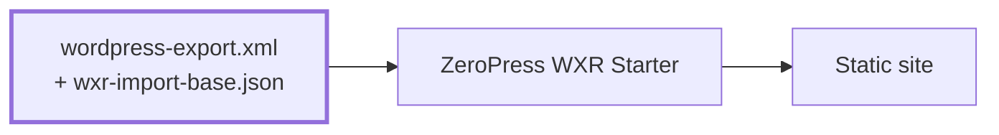

# ZeroPress Static

Keep WordPress as your editor and publish a static site with
[ZeroPress WXR Starter](https://github.com/zeropress-app/zeropress-starter-wxr).
ZeroPress Static exports published content and build settings. You can download
the files or publish them to GitHub, where your configured build service can
build and deploy the site.

Requires WordPress 6.8+, PHP 8.2+, and a single-site installation.
License: GPL-2.0-or-later.

## Publishing flow

ZeroPress Static generates `wordpress-export.xml` and `wxr-import-base.json`.
The WXR starter builds your static site from these two files.



You can also download both files and run the WXR starter build yourself.

## Installation

### Automatic installation

Install ZeroPress Static from the WordPress Plugin Directory:

1. In your WordPress admin, open **Plugins → Add New Plugin**.
2. Search for **ZeroPress Static**.
3. On the ZeroPress Static result, select **Install Now**, then **Activate**.
4. Open **ZeroPress → Settings** to configure the plugin.

### Manual installation

Download the installation ZIP from the repository's
[releases](https://github.com/zeropress-app/zeropress-static/releases). In
WordPress, open **Plugins → Add New Plugin → Upload Plugin**, select
`zeropress-static-v<version>.zip`, install it, and activate it.

For a source checkout, copy this directory to
`wp-content/plugins/zeropress-static/` and activate it in WordPress. The plugin
files are ready to use; installation requires no Node.js, Composer or build step.

## First publication

1. Set up a project from the
   [WXR starter](https://github.com/zeropress-app/zeropress-starter-wxr). For GitHub
   publishing, keep `wordpress-export.xml` and `wxr-import-base.json` in the root
   of the existing branch you intend to use.
2. Open **ZeroPress → Settings**, configure the sections you need, and save them.
3. To use **Publish to GitHub**, configure [GitHub publishing](#github-publishing).
4. Open **ZeroPress → Publish** and select **Prepare publishing data**. Review
   the content counts, file sizes and publishing destination.
5. Download the files, or select **Publish to GitHub** and confirm the repository,
   branch and files in the dialog.

GitHub publishing replaces both files in one commit. Manage their settings in
the plugin; direct edits to the generated files are replaced on the next
publication. A successful publication confirms the GitHub update. Building and
hosting are configured in your starter project.

## Settings

All options are on **ZeroPress → Settings**. Use the section links to move within
the page. The navigation stays visible while scrolling on desktop and wraps on
mobile. Save changes before preparing publishing data.

The **Site** section shows the WordPress title, description, site language,
timezone, posts per page and site icon as read-only information. Links open the
corresponding WordPress settings. These values are read again whenever publishing
data is prepared. **Icon URLs for publishing** shows the URLs after saved media
replacement rules have been applied.

### Static site URL and search engines

Enter the static site's address without a path, for example
`https://blog.example.com`. It is required when comment writing is enabled.
Otherwise, leaving it blank omits `sitemap.xml`, `feed.xml` and the
`<link rel="canonical">` tag that identifies a page's preferred URL.

When set, this address is also used for the WXR site addresses, post and page
links, and menu links within the WordPress site's address. Paths relative to the
WordPress home address are kept, with any WordPress installation subdirectory
removed. Queries and fragments are preserved. WordPress can therefore use a
separate hostname for administration while the static site keeps its address.
With no static site URL, the WXR retains the WordPress addresses.

This applies to WXR link fields. Links within article bodies keep their saved
addresses. Media URLs follow the media replacement rules, and comments use the
configured WordPress REST API URL.

**Allow search engine crawling** starts off. When unchecked, the default build
writes `Disallow: /` in the static site's `robots.txt`; checking it writes
`Allow: /`. A custom `public/robots.txt` in your build project takes precedence.
The setting controls crawler instructions; access to a private site is managed
by your hosting.

### GitHub publishing

Enter the repository URL and an existing **Publishing branch**, then select
**Save publishing target**. The branch field starts with `main`.

Create a fine-grained token for **Only select repositories**, select **only the
publishing repository**, and grant **Contents: Read and write**. Use **Register
token**, then **Test connection** to check access to the branch and both files.
The branch must allow direct commits for publishing to succeed.

Token registration is separate from saving the publishing target. A registered
token is shown as a status. To replace it, use **Delete saved token**, confirm,
then register a new token. Deletion removes the plugin's stored copy; revoke the
token on GitHub if you also want to invalidate it there.

### Media URL replacements

Use this section when exported media should use a different address. Add source
and destination prefixes, for example:

| Source URL prefix | Destination URL prefix |
| --- | --- |
| `https://blog.example.com/wp-content/uploads/` | `https://media.blog.example.com/wp-content/uploads/` |
| `https://old-wp.example.com/wp-content/uploads/` | `https://media.blog.example.com/wp-content/uploads/` |

Trailing slashes are added automatically. If several rules match, the longest
source prefix wins. Each original value is replaced once, preserving the rest of
the path, query and fragment.

Rules apply to media URLs in saved HTML, supported media-block attributes,
attachment URLs and site-icon URLs before export. Ordinary article links, custom
code and shortcode output are outside this process. The rules change exported
URLs; files remain at their existing locations. The destination URLs must serve
the media to your site's visitors.

The WordPress Site Icon supplies the favicon and Apple touch icon using
WordPress's 512 and 180 size requests. The 512 request selects the full Site Icon
attachment, which may already be cropped. If no Site Icon is set, the build
project's icon defaults remain in place.

### Menus

Select a classic WordPress menu for `primary`, `footer`, or a custom ID used by
your static theme. Choose **Do not publish** to leave a slot empty. Only selected
menus and their public targets are exported. The same source menu can serve more
than one ID.

Create and edit menus in WordPress's classic menu editor, available with themes
that support it. Assignments in this plugin are independent of WordPress theme
locations. Block navigation is not supported. Renaming a selected menu preserves
the assignment; deleting it requires choosing another menu or clearing the slot.
Theme-provided links, such as a home link, are controlled by the static theme.

Custom IDs start with a lowercase letter and may contain lowercase letters,
digits, hyphens and underscores, up to 64 characters. `constructor` and
`prototype` are reserved. Selections are exported as `import.menu_mapping` in
the base JSON. Media replacement rules are applied in the plugin before export.

### Search and content navigation

Search, RSS and chronological archives start enabled. RSS also requires a static
site URL; the selection is retained if that URL is blank. Search and archive
display depends on the theme. **Enable search** controls site search separately
from the search-engine crawling setting.

### Comments

Comment display and writing are separate options, both off by default. To display
comments, enter a WordPress REST API URL accessible to site visitors, such as
`https://wp.example.com/wp-json/wp/v2`. A subdirectory installation can use
`https://wp.example.com/blog/wp-json/wp/v2`. Original post and page IDs are preserved.
Query-style `?rest_route=` URLs are not supported.

With display enabled and writing disabled, the blog theme shows the comment list
without a form or reply buttons. **Allow comment writing on the static site**
requires a saved **Static site URL**. Leaving **Use Cloudflare Turnstile**
unchecked uses the built-in proof-of-work (PoW) check, which needs no keys.
WordPress's login requirement, closed comments, moderation and spam checks still
apply.

To use Turnstile, configure its widget for the static site's hostname. Check
**Use Cloudflare Turnstile**, enter the matching Site Key and Secret Key, and
select **Save Turnstile settings**. The saved Site Key remains visible; the Secret
Key is represented by its storage status. **Change keys** replaces the pair;
**Cancel** restores the saved settings. Turning Turnstile off retains the keys.
**Delete saved keys** removes both keys and turns it off, so enabled comment
writing continues with PoW.

Comment display and API URL changes require republishing. Writing and Turnstile
settings apply when the theme next checks the writing policy, without rebuilding
the site. With comment display off, the supported theme makes no comment API
requests.

#### API access

The WordPress admin can stay private while these paths are accessible to site
visitors:

| Path | Methods | Purpose |
| --- | --- | --- |
| `/wp-json/wp/v2/comments` | `GET`, `POST` | Read comments and submit comments or replies |
| `/wp-json/zeropress-static/v1/comments/policy` | `GET` | Read the writing policy |
| `/wp-json/zeropress-static/v1/comments/challenge` | `POST` | Obtain verification data before submission |

Read-only comments use the two `GET` endpoints. Preserve query parameters such
as `?post=123&page=2`. Include any WordPress installation subdirectory in every
path and allow `OPTIONS` where CORS preflight is needed. API access and proxy
configuration are managed on your server.

Challenge requests and comment submissions marked `zeropress_client=theme-v1`
must send an `Origin` matching the saved static site URL, including the scheme,
hostname and port. A preview at another address can read comments but cannot
submit them. Turnstile also verifies the widget hostname and action.

The marker selects this integration; it does not authenticate a theme. Other
REST clients retain their existing WordPress policies. A custom HTTP client can
supply an Origin header, so the origin check supplements PoW or Turnstile
verification. The theme retains the comment list if the writing policy cannot be
loaded and offers a retry. Uncertain comment submissions are not automatically resent.

#### Comment request limits

Each IP address can make **60 challenge requests** and **5 marked comment or
reply submission attempts per minute**, shared across all posts. The two quotas
are separate and reset at each minute boundary. Failed verification attempts
also count. Limits are checked before PoW or Turnstile verification; exceeding a
quota returns HTTP `429`, with a `Retry-After` header and `data.retry_after` in
the JSON response indicating the seconds to wait. Reading comments and policies,
and unmarked clients using WordPress's existing policies, are unaffected.

The client address comes from PHP's `REMOTE_ADDR`. If WordPress runs behind a
proxy, configure the trusted web server to restore the visitor's IP address;
otherwise visitors may share the proxy's quota. The plugin does not trust
client-supplied forwarding headers. Counters store a keyed hash of the address,
are excluded from option autoloading, and expired records are cleaned up in
bounded batches as new counters are created. Uninstalling removes these records.
If the client address or counter storage is unavailable, submissions return HTTP
`503` until the server can enforce the limits again.

### Newsletter connection

Prepare a signup page with a newsletter service such as Hostinger Reach,
Omnisend or Mailchimp, then enable **Show newsletter signup**. This section
connects the static site to that page; the service handles subscriptions and
mail delivery.

- **Signup page URL** opens in a new tab.
- **Embedded signup page URL** opens in a popup in the blog theme. The page must
  allow iframe embedding. If both URLs are supplied, the signup link is also
  available as a fallback.

At least one URL is required. Use an HTTP(S) page URL or a site-relative path
such as `/subscribe/`, including any query or fragment. Enter a page address,
not an HTML embed snippet or form-submission endpoint.

Title, description and button text are optional; blank fields use the theme's
defaults. Title and button text allow 200 characters, description 2,000, and each
URL 2,048. Turning the prompt off retains the saved values.

### Display and credits

The optional copyright or legal notice is plain text. Leaving it blank omits a
separate notice in the blog theme. **Show ZeroPress attribution** adds
`Published with ZeroPress` to the theme footer. **Show ZeroPress generator
information** adds `<meta name="generator">` to the HTML. Both options start on.

### Custom CSS and HTML

Custom CSS is included as a separate stylesheet. Custom HTML is inserted before
`</head>` or `</body>` and can include scripts for analytics or widgets.

CSS and each HTML insertion location have their own apply checkbox, off by
default. Code remains editable and saved while disabled; only enabled, non-empty
code is included in the next publication. Each field accepts 65,536 characters.
WordPress code editors follow your profile's syntax-highlighting preference.
CSS editing requires `edit_css`, and HTML requires `unfiltered_html`, in addition
to `manage_options`. WordPress permission restrictions apply.

## Publishing behavior

Prepare data again after changing settings or content. Preparation expires after
ten minutes. Changes to the target files on GitHub also require preparing again;
unrelated repository commits are preserved.

When the prepared data matches the previous publication, **No changes to publish**
confirms that publishing is unnecessary. To publish intentionally, expand
**Republish options** and select **Publish to GitHub again**. This creates a new
commit by updating the WXR generation time. Post dates and build settings stay
unchanged. This can trigger the build service configured for
your repository. The branch is never force-updated.

If a publication response is lost, the plugin checks the result once without
repeating the write. **Publication needs verification** means you should inspect
the repository before preparing and publishing again.

## Export scope and limits

The export includes published posts and pages without passwords, their used
categories and tags, public author display names, selected classic menus, and
required media metadata. Drafts, private or scheduled content, comment records,
login names, user email addresses and arbitrary post metadata are excluded.
Information written into published content remains part of that content.

Saved HTML and static block markup are exported. Shortcodes, dynamic blocks and
page builders are not executed; custom post types and block navigation are not
converted. Excerpts and taxonomy descriptions are exported as plain text.
Titles and other display text are decoded once to preserve characters such as
apostrophes and ampersands.

Publishing is a manual full export. Preparation, downloads and publication are
separate requests; downloads and publication regenerate the data to check for
changes. Each request shares its resource budget across generation and GitHub
communication.

For these operations, the plugin requests WordPress's administrator memory
allowance (`WP_MAX_MEMORY_LIMIT`) and checks the effective PHP `memory_limit`.
File size is governed by available memory, including conservative headroom for
serialization and transport. The memory estimate is a preflight check, not a
measurement of peak usage. Increase the server's PHP memory allowance and, when
needed, `WP_MAX_MEMORY_LIMIT` if this check stops an export. Hosting restrictions
may prevent WordPress from raising the limit.

With a positive PHP `max_execution_time`, the plugin stops starting work five
seconds before that setting's duration has elapsed since the request began.
This is a wall-clock budget including WordPress startup and network waits; PHP's
own execution-time accounting can differ. A setting of `0` leaves the overall
request budget unlimited. PHP-FPM, web servers and proxies can still terminate
requests according to their own limits.

GitHub HTTP requests use the remaining time. When PHP has no execution-time
limit, each GitHub request defaults to a 30-second timeout. The
`zeropress_static_github_request_timeout` filter accepts a positive finite number
of seconds. For example, the following allows up to 60 seconds per GitHub request;
a finite overall request budget still takes precedence:

```php
add_filter( 'zeropress_static_github_request_timeout', static function () {
    return 60;
} );
```

Controlled resource errors show the applicable limits next to the action.
If the server terminates a publication request before returning its result,
check GitHub before preparing again; the plugin cannot infer whether the branch
was updated from a lost response.

## Stored data and external services

GitHub tokens and Turnstile secrets use authenticated AES-256-GCM encryption with
separate keys derived from WordPress secrets. Their plaintext is never
returned to the admin screen. If the WordPress secrets change, register the
credentials again. Deactivation retains settings; uninstall removes the plugin's
settings, credentials and temporary verification records.

### GitHub

Connection tests, preparation with a configured GitHub connection, and confirmed
publication contact `https://api.github.com`. The token authenticates requests;
publication sends the WXR content and generated build settings. There is no
telemetry or scheduled synchronization.

- [GitHub terms](https://docs.github.com/en/site-policy/github-terms/github-terms-of-service)
- [GitHub privacy](https://docs.github.com/en/site-policy/privacy-policies/github-general-privacy-statement)

### Cloudflare Turnstile

When selected for comment writing, the static theme loads
`https://challenges.cloudflare.com/turnstile/v0/api.js`. WordPress sends the
widget token and Secret Key to
`https://challenges.cloudflare.com/turnstile/v0/siteverify` for verification. The
optional visitor-IP parameter is not sent. PoW and read-only comments do not use
this service. Turnstile verification failures do not switch to unprotected writing.

- [Cloudflare terms](https://www.cloudflare.com/terms/)
- [Cloudflare privacy](https://www.cloudflare.com/privacypolicy/)

### Newsletter pages

Newsletter URLs are exported for use by the static theme. Subscriptions and
visitor data submitted on those pages are handled by the newsletter service you
choose.

## Support

Use [GitHub Issues](https://github.com/zeropress-app/zeropress-static/issues) for
questions, bug reports and feature requests. Include the plugin, WordPress and
PHP versions, steps to reproduce, and expected and actual results. Remove
credentials and personal data from attachments.

Report security vulnerabilities through
[private vulnerability reporting](https://github.com/zeropress-app/zeropress-static/security/advisories/new).
